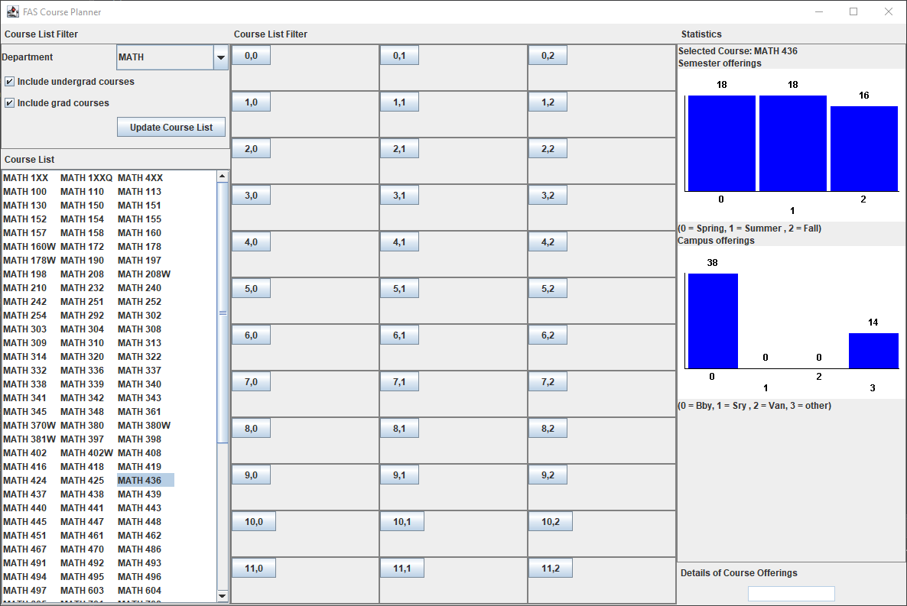
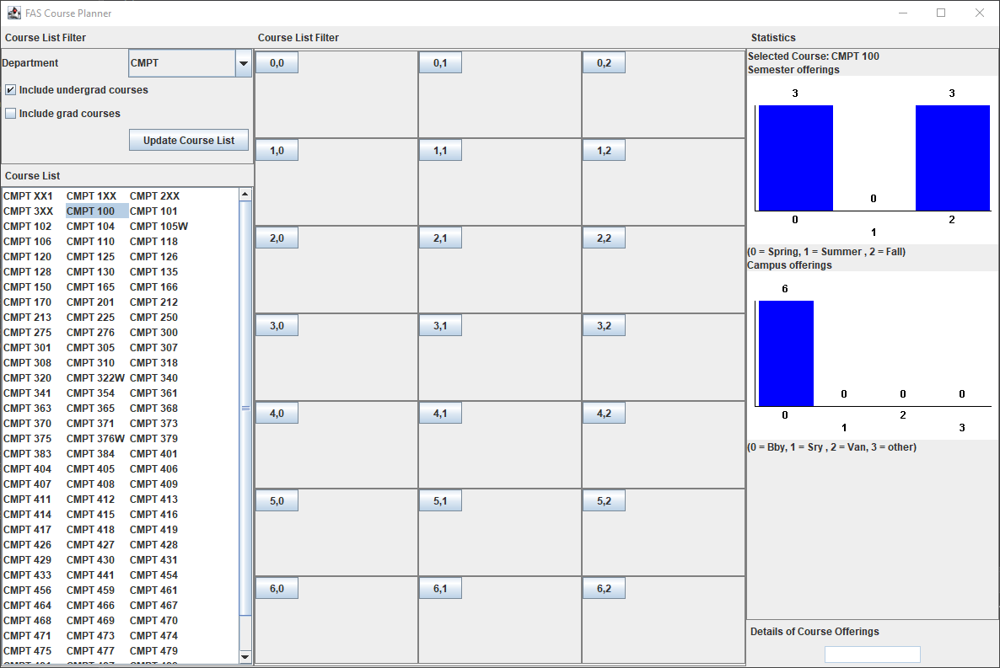

# FAS Course Planner

A Java Swing application designed to help students and administrators plan and analyze course offerings. It parses course data from CSV files and provides an interactive interface for viewing course details, offerings, and statistics.

## Features

- **Data Parsing**: Automatically imports course data from `.csv` files (e.g., `course_data_2014.csv`).
- **Interactive UI**:
    - **Subject & Course Listing**: Navigate through different subjects and their respective courses.
    - **Course Offerings**: View detailed information about specific course sections, locations, and instructors.
    - **Course Statistics**: Analyze enrollment data and capacities through integrated charts or histograms.
- **Hierarchical Domain Logic**: Organizes data into a structured hierarchy: Library -> Subject -> Course -> Offer -> Section.
- **Visual Analysis**: Includes a histogram/statistical view for better data visualization.

## Screenshots

<table width="100%">
  <tr>
    <td width="50%" align="center" valign="top"> MATH course list and statistics</td>
    <td width="50%" align="center" valign="top"> CMPT course list and statistics</td>
  </tr>
</table>

## Download (Windows)

A ready-to-run Windows build is in [`dist/CoursePlanner/`](dist/CoursePlanner/). Keep the folder together (the `doc/course_data_2014.csv` data file must stay next to the launcher) and double-click `CoursePlanner.exe`. Java must be installed.

## Project Structure

- `domain_logic`: Core business logic for handling courses, subjects, and offerings.
- `graphicalUI`: Swing components and panel management for the user interface.
- `histogram`: Specialized components for statistical visualization.
- `test_driver`: Contains the `Driver` class for console-based testing and data validation.

## Data Format

The application expects a CSV file with the following columns:
1. Term/Semester (STRM)
2. Subject
3. Catalog Number
4. Location
5. Enrollment Capacity
6. Component (e.g., LEC, TUT)
7. Total Enrollment
8. Instructors

## How to Run

1.  **Main Application**: Run the `graphicalUI.GUIDisplayer` class to launch the GUI.
2.  **Console Test**: Run `test_driver.Driver` to verify data parsing in the console.

### Requirements
- Java JDK 8 or higher.
- Course data CSV file located in `doc/course_data_2014.csv`.

---
*Developed for FAS Course Planning.*
